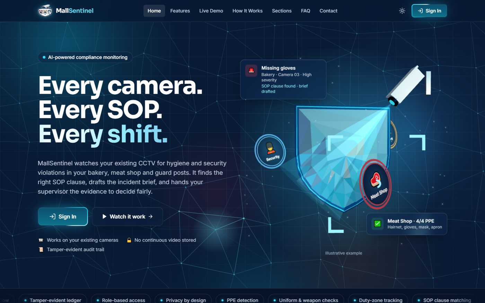
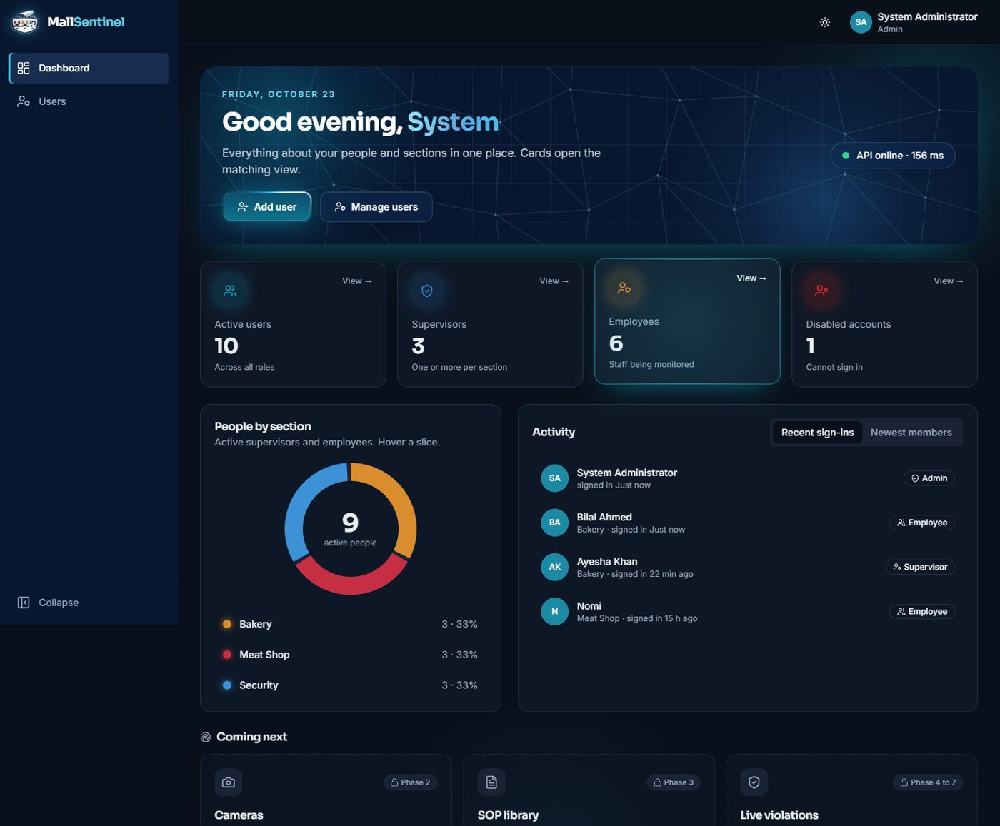
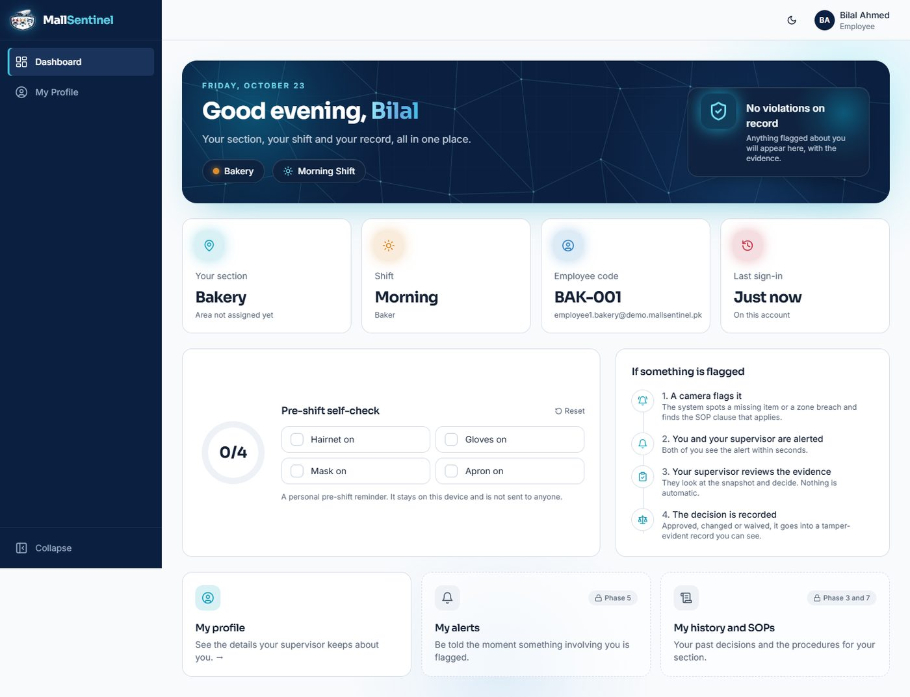
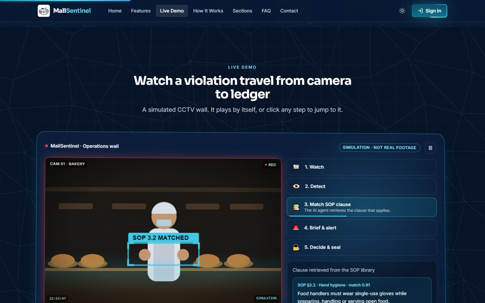
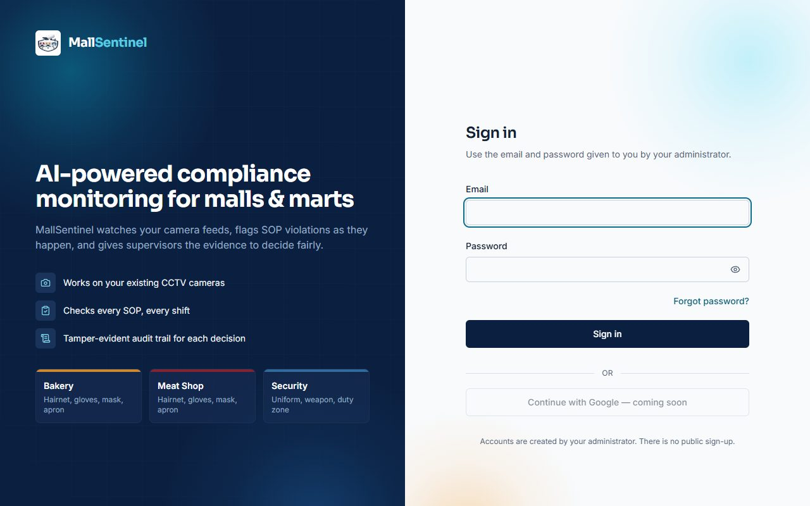

# MallSentinel

**AI-powered compliance monitoring for Pakistani malls and marts.**
MallSentinel will watch a mall's existing CCTV cameras for SOP violations in its **Bakery**, **Meat Shop** and **Security** sections, find the SOP clause that applies, draft the incident brief, alert the supervisor and employee in real time, and keep every decision in a tamper-evident audit ledger.

> Final Year Project, FAST-NUCES Chiniot-Faisalabad, 2026.
> Team: Numan Asghar, Muhammad Sohaib, Fahad Javaid.



## Project status

| Phase | Scope | Status |
|---|---|---|
| 0 | Foundation: Docker stack, backend and frontend skeletons, migrations, tests | Done |
| 1 | Authentication, role-based access, user management, audit ledger, public website, role dashboards | Done |
| 2 | Cameras and department configuration | Planned |
| 3 | SOP management | Planned |
| 4 | Computer-vision service (YOLO + tracking) | Planned |
| 5 | Real-time alerts (WebSockets) | Planned |
| 6 | AI agent (RAG over SOPs, severity, incident briefs) | Planned |
| 7 | Evidence review, penalties, records | Planned |
| 8 and 9 | Compliance chatbot, hardening and deployment | Planned |

The detailed checklist lives in [docs/IMPLEMENTATION_PLAN.md](docs/IMPLEMENTATION_PLAN.md). **No AI, computer-vision or chatbot code exists yet**; the dashboards mark those features as planned and show no invented numbers.

## What works today

**Public website (`/`)**
- 3D hero scene (react-three-fiber): faceted shield, swivelling CCTV camera with a light beam, three orbiting section discs. Falls back to a static SVG when WebGL is unavailable or motion is reduced.
- Interactive background web that reacts to the cursor, floating feature cards, a simulated CCTV wall that plays the five-step violation flow, scroll-driven timeline, count-up stats and an FAQ.
- Light and dark themes, responsive from 360 px up, respects `prefers-reduced-motion`.

**Authentication and access control**
- One Sign In page for all roles. The backend identifies the role and the app redirects to `/admin`, `/supervisor` or `/employee`. No public sign-up.
- Short-lived JWT access token plus a rotating refresh token in an httpOnly cookie. Each browser tab keeps its own session.
- argon2 password hashing, lockout after 5 failed attempts (15 minutes, configurable), disabled-account handling, forgot and reset password by single-use expiring email (sent through Gmail SMTP).
- `require_role(...)` on every protected endpoint. **Admins manage supervisors only** (and, later, the CCTV monitoring system). **Supervisors manage the employees of their own section** and issue penalties to them.
- Google sign-in is prepared in the schema (`auth_provider`, nullable `google_sub`) but not implemented.

**Audit ledger**
- Every login, user change, role change, disable and password reset is written to a hash-chained `audit_log`. A database trigger blocks `UPDATE`, `DELETE` and `TRUNCATE`, and the chain can be verified.

**Dashboards**
- Admin, Supervisor and Employee dashboards with live counts, an interactive donut, activity tabs, shift coverage, a personal pre-shift checklist and an API status chip.

| | |
|---|---|
|  |  |
|  |  |

## Tech stack

| Layer | Choice |
|---|---|
| Database | PostgreSQL 16 with `pgvector` (Docker) |
| Backend | Python 3.11, FastAPI, SQLAlchemy 2.0 (async), Alembic, Pydantic v2 |
| Auth | Own JWT + refresh cookie, argon2, RBAC |
| Frontend | React 18, Vite, TypeScript (strict), Tailwind CSS, shadcn/ui, TanStack Query, React Router, react-hook-form + zod, react-three-fiber |
| Email | Gmail SMTP with an App Password (penalty notices, password reset) |
| Dev infrastructure | Docker Compose: `db`, `backend`, `adminer` (DB UI) |
| Planned | OpenCV + Ultralytics YOLO, WebSockets, local sentence-transformers embeddings, provider-agnostic LLM client |

## Repository layout

```
backend/     FastAPI app, Alembic migrations, pytest suite, Dockerfile, .env.example
frontend/    React + Vite app (runs standalone with `npm run dev`), .env.example
docs/        Implementation plan, design direction, screenshots
resources/   Logo (the SRS is the source of truth for requirements)
docker-compose.yml   db, backend, adminer
CLAUDE.md    Project rules and decisions
```

## Who does what

| Role | Responsibilities |
|---|---|
| **Admin** | Creates and manages the section **supervisors**. Will manage the **CCTV monitoring system** (cameras, duty zones, live monitoring), which is planned for Phase 2 onwards. Admins cannot see or change employees. |
| **Supervisor** | Manages the **employees of their own section** (create, edit, disable, unlock, remove), reviews an employee's record and **issues penalties**. Each penalty is **emailed to the employee** at the address on their account. |
| **Employee** | Sees their own dashboard, their own **penalties** and their own profile. Nothing about anyone else. |

## Gmail setup (for penalty and password-reset emails)

Email goes through Gmail SMTP. Without credentials the app still works: penalties are saved and shown with "Email not set up" and a **Resend** button.

1. Turn on **2-step verification** for the Gmail account that will send the emails.
2. Create an **App Password** (Google Account, Security, App passwords).
3. In `backend/.env` set `SMTP_USER` to that Gmail address and `SMTP_PASSWORD` to the App Password (no spaces). Use the App Password, never the normal account password.
4. Recreate the backend: `docker compose up -d --force-recreate backend`.

Employees should be created with their own (Gmail) address, because that is where their penalty notices are sent.

## Getting started

**Requirements:** Docker Desktop and Node.js 20+.

```bash
# 1. Root env: database credentials for docker compose
cp .env.example .env              # set POSTGRES_PASSWORD

# 2. Backend env
cp backend/.env.example backend/.env
#    - use the same password in DATABASE_URL and TEST_DATABASE_URL
#    - JWT_SECRET: python -c "import secrets; print(secrets.token_urlsafe(48))"
#    - SEED_ADMIN_EMAIL, SEED_ADMIN_PASSWORD, SEED_DEMO_PASSWORD
#      (use a real-looking email domain; .local, .test and .example are rejected)

# 3. Start the database, backend (runs migrations on boot) and Adminer
docker compose up -d --build

# 4. Seed the admin, the three departments and demo accounts (idempotent)
docker compose exec backend python -m app.seed

# 5. Frontend
cd frontend
cp .env.example .env
npm install
npm run dev
```

| Service | URL |
|---|---|
| Website and app | http://localhost:5173 |
| API and docs | http://localhost:8000/docs (base path `/api/v1`) |
| Adminer (DB UI) | http://localhost:8080 (system PostgreSQL, server `db`) |

All credentials come from environment variables; nothing is hardcoded. The seed prints the demo account emails (one supervisor and two employees per department); they share the password you set in `SEED_DEMO_PASSWORD`. To change the admin login later, edit `.env`, recreate the backend and run `docker compose exec backend python -m app.seed --sync-admin`.

### Useful commands

| Goal | Command |
|---|---|
| Run the backend tests (Python 3.11, separate test database) | `docker compose exec backend python -m pytest -q` |
| Type-check and build the frontend | `cd frontend && npm run build` |
| New migration | `docker compose exec backend alembic revision --autogenerate -m "message"` |
| Stop everything (keeps data) | `docker compose stop` |
| Remove containers and delete the database volume | `docker compose down -v` |

## API overview (`/api/v1`)

| Endpoint | Who |
|---|---|
| `POST /auth/login`, `/auth/refresh`, `/auth/logout`, `/auth/forgot-password`, `/auth/reset-password` | public (refresh uses the httpOnly cookie) |
| `GET /auth/me`, `GET /departments` | any signed-in role |
| `GET /health` | public |
| `GET/POST /supervisors`, `GET/PATCH /supervisors/{id}`, `POST /supervisors/{id}/disable`, `/enable`, `/unlock` | admin (supervisors only; employees are invisible to admins) |
| `GET/POST /employees`, `GET/PATCH/DELETE /employees/{id}`, `POST /employees/{id}/unlock` | supervisor, own department only (delete is a soft delete) |
| `GET/POST /penalties`, `GET /penalties/{id}`, `POST /penalties/{id}/resend-email` | supervisor, own department only |
| `GET /penalties/mine` | employee, their own penalties only |

Errors always look like `{"detail": "...", "code": "SOME_CODE"}`.

## Security and privacy

- Passwords are hashed with argon2; refresh and reset tokens are stored only as hashes and are single use or rotated.
- Wrong-role requests get `403`. Supervisors cannot see or edit other departments (they get `404`).
- Account lockout, no account enumeration on login or password reset, and an append-only audit ledger.
- By design, the finished system stores only violation snapshots and short clips with metadata, never continuous video, and serves evidence only through an authenticated endpoint.

## Documentation

- [Implementation plan and progress](docs/IMPLEMENTATION_PLAN.md)
- [Public website design direction](docs/DESIGN_DIRECTION.md)
- [Project rules (CLAUDE.md)](CLAUDE.md)

## License

No license has been chosen yet. Until one is added, all rights are reserved by the authors.
